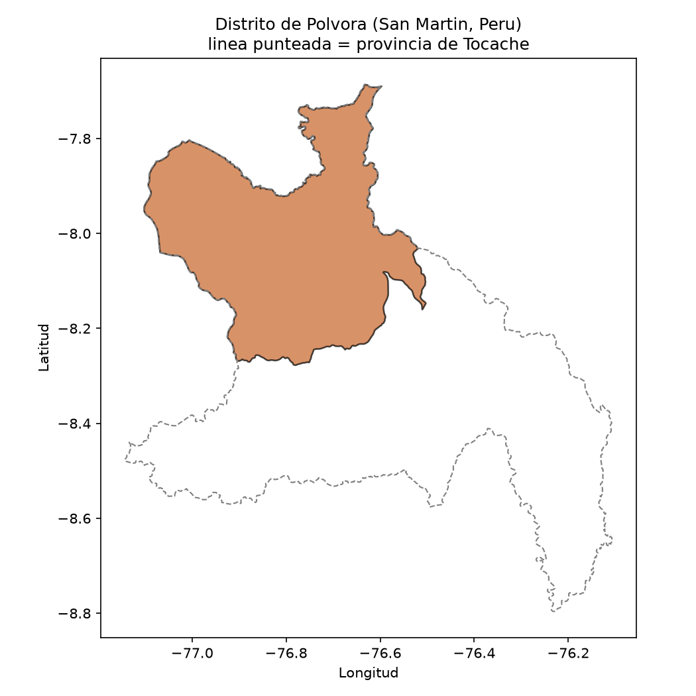
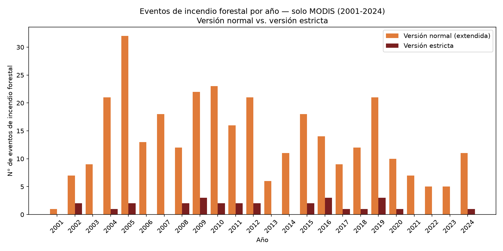
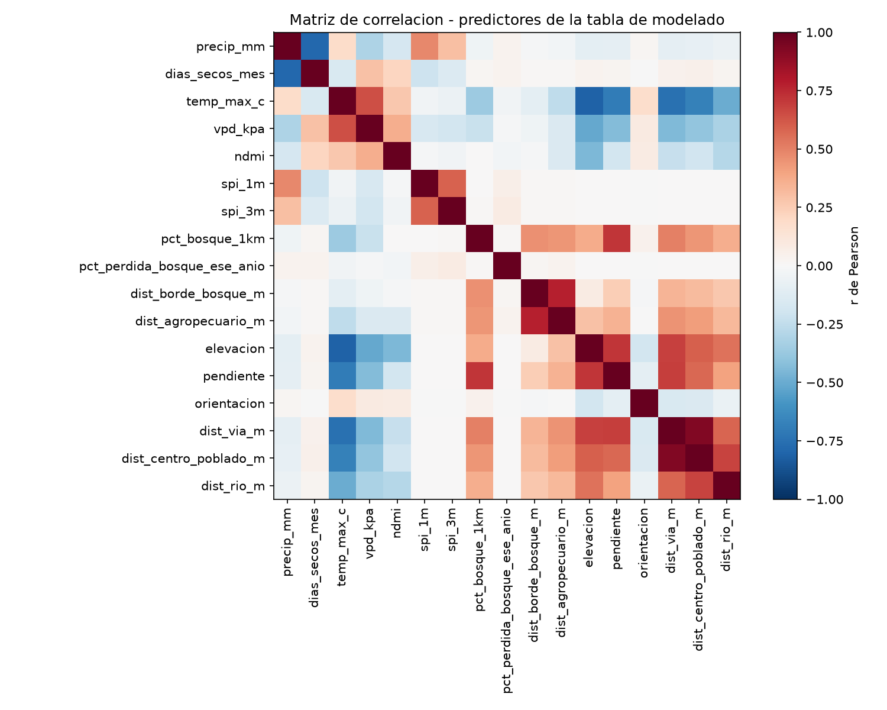
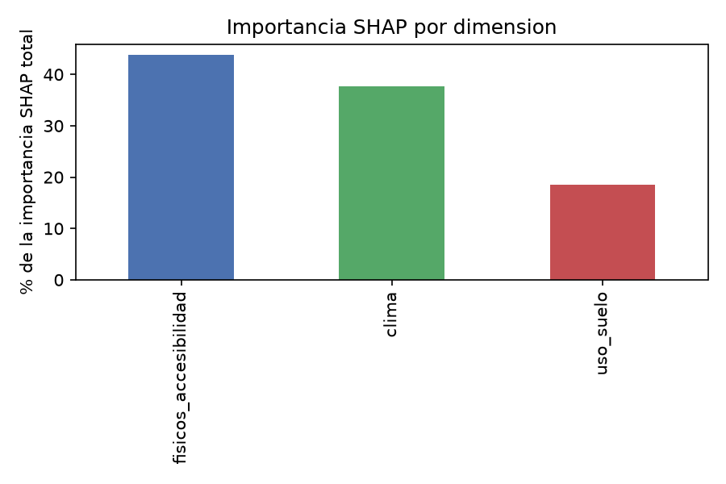
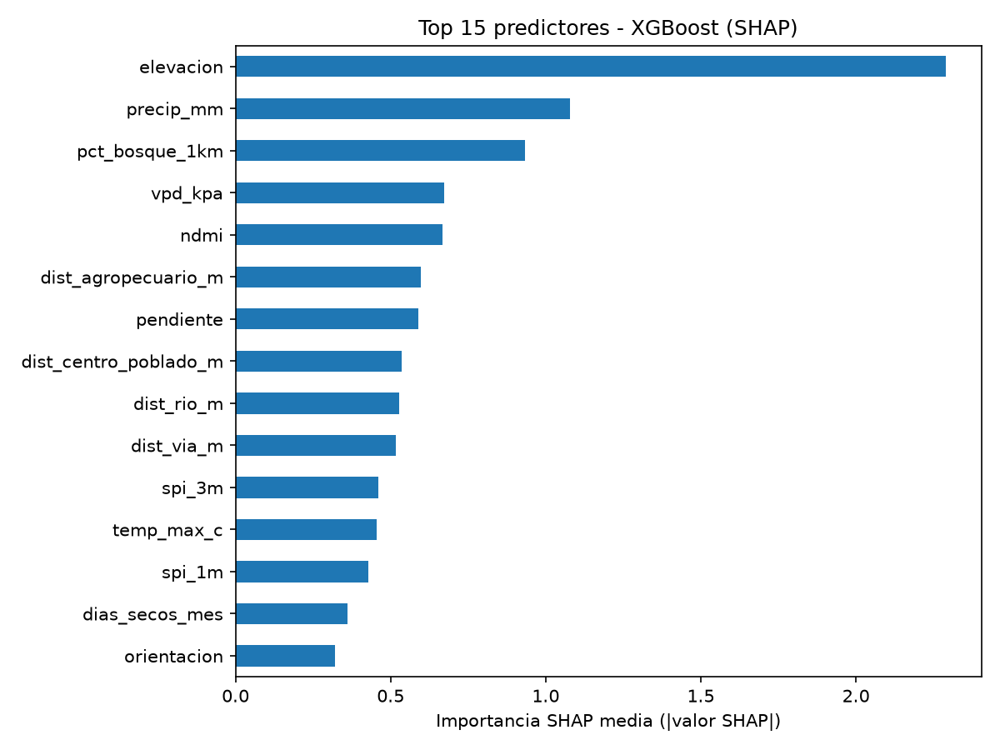
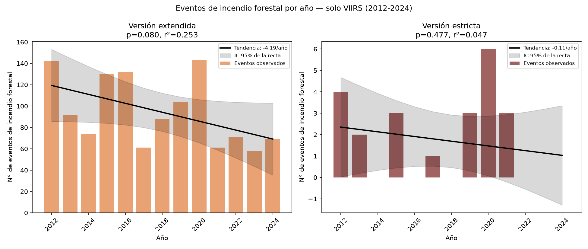
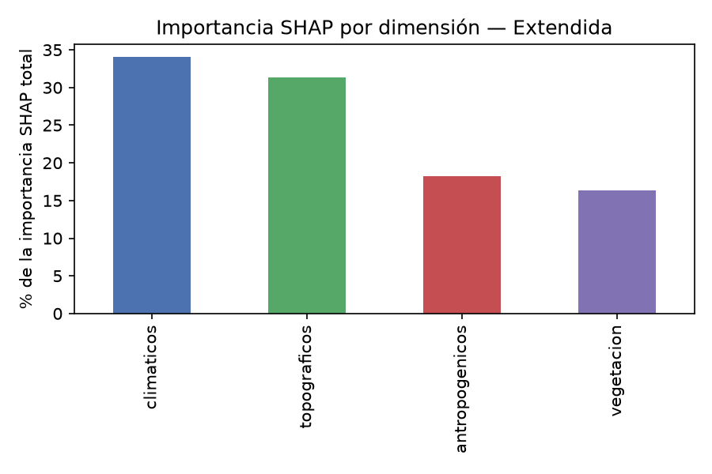
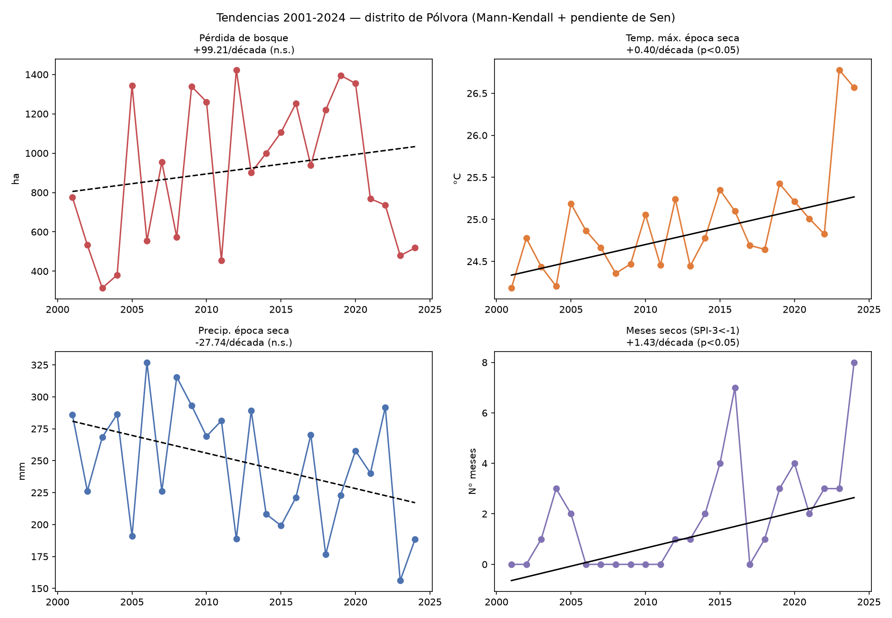
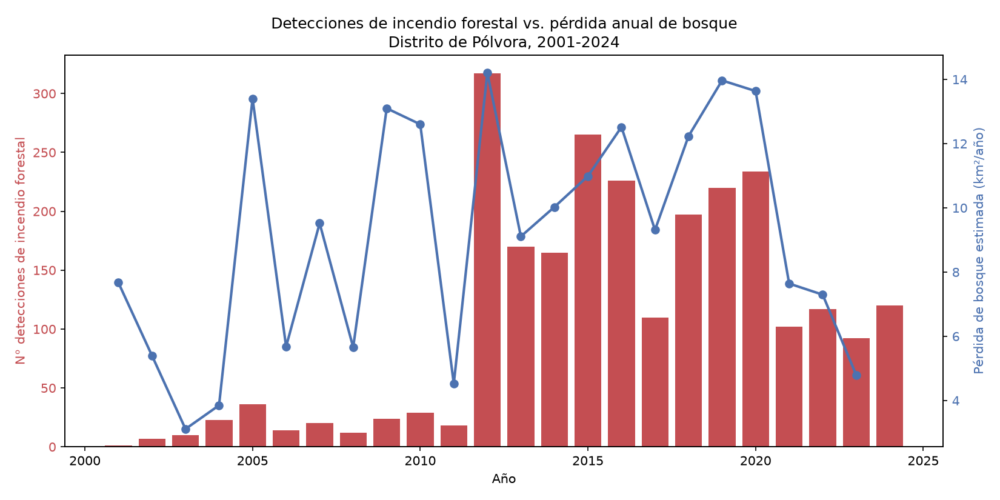

# Informe de viabilidad: predicción de incendios forestales con ML explicable

**Distrito de Pólvora, provincia de Tocache, región San Martín, Perú**
Generado: 2026-09-16 · Este documento es el cierre de una prueba de viabilidad, **no** el sistema final de la tesis.

---

## Veredicto

> ## ✅ VIABLE a nivel distrito — con una salvedad importante sobre el conteo de incendios
>
> | Criterio | Umbral | Resultado | ¿Cumple? |
> |---|---|---|---|
> | N° de incendios forestales en el periodo | ≥ 100 | **2,529** (definición original, Fase 3) / **74** (definición estricta, Fase 3b) | ⚠️ Depende de la definición — ver nota |
> | Predictores de clima y uso de suelo disponibles para el periodo común | Requisito | Todos verificados (Fase 4) | ✅ Sí |
> | AUC-ROC con validación espacial | ≥ 0.70 | **0.925** (Random Forest) / **0.946** (XGBoost) | ✅ Sí, con margen amplio |

**Nota sobre el conteo de incendios (léase junto con la Fase 3b):** con la definición original (bosque en t-1 y en t) el conteo es 2,529-2,625 y supera el umbral de viabilidad (≥100) con margen amplio. Pero al depurar la clasificación con un criterio más estricto y defendible (bosque confirmado también uno y dos años después, ≥80% de bosque real en el píxel, y más de 500 m de cualquier área agropecuaria), el conteo cae a **74** — que según los mismos criterios de la consigna cae en la banda **"marginal" (50-99)**, no en "viable". Esto no invalida el veredicto (el modelo predictivo sí aprende señal real, con AUC-ROC alto bajo ambas definiciones), pero sí es una advertencia honesta: la mayoría de los "incendios forestales" de este distrito ocurren cerca del borde agrícola, no en el interior profundo del bosque, y esa es información que debe discutirse en la tesis, no promediarse hasta que desaparezca.

**Nota importante sobre el ámbito:** este informe corresponde al distrito de **Pólvora**, no al de Tocache. El ámbito se cambió a mitad del pipeline por pedido explícito (ver Fase 1). Todas las fases se rehicieron sobre Pólvora.

---

## 1. Ámbito de estudio (Fase 1)

- **Distrito:** Pólvora (ubigeo INEI 221003), provincia Tocache, región San Martín.
- **Área:** 2,263.7 km² (verificada por dos métodos independientes: atributo del dataset y recálculo propio en UTM 18S).
- **Fuente:** IGN/HDX (COD-AB Perú), el dataset oficial de límites administrativos — se prefirió sobre geoBoundaries porque este último no publica nivel distrital (ADM3) para Perú.
- Verificado visualmente contra imagen satelital Sentinel-2 y contra el listado completo de los 5 distritos de la provincia.

---

## 2. Detecciones de calor — NASA FIRMS (Fase 2)

**Fuente:** Area API de FIRMS (el endpoint por país estaba caído al momento de la descarga), fuentes de calidad científica `MODIS_SP` y `VIIRS_SNPP_SP`.

| Sensor | Periodo | Detecciones (Perú) | Detecciones (distrito) |
|---|---|---|---|
| MODIS | 2001-2026-09 | 600,957 | 1,472 |
| VIIRS S-NPP | 2012-01-20 a 2026-09 | 1,643,931 | 4,430 |

- Estacionalidad muy marcada: **julio-septiembre concentran la mayoría de las detecciones** (pico en agosto), consistente con la época seca amazónica.
- Confianza: MODIS media 61.1 (escala 0-100); VIIRS 93.5% "nominal", 4.7% "alta", 1.8% "baja".

---

## 3. Filtro de bosque en pie (Fase 3)

**Fuente de uso de suelo:** MapBiomas Perú Colección 3 (1985-2024), única colección publicada como asset de Earth Engine (se verificó que no existe una Colección 4 en EE).

**Criterio de bosque:** códigos 3, 4, 5, 6 (Nivel 1 "Formación boscosa" de la leyenda oficial). El código 9 (Plantación forestal) se excluyó a propósito: la leyenda de MapBiomas lo clasifica como "Área agropecuaria", no como bosque natural.

**Criterio de resolución:** clase mayoritaria (moda) de MapBiomas (30 m) dentro de un cuadrado centrado en cada detección, con lado igual a la resolución nominal del sensor (375 m VIIRS, 1000 m MODIS).

| Categoría | Detecciones | % |
|---|---|---|
| Incendio forestal (bosque → bosque) | 2,625 | 44.5% |
| Quema agrícola u otra (no bosque) | 3,048 | 51.6% |
| Quema de deforestación (bosque → no bosque) | 229 | 3.9% |

**Contraste con Hansen Global Forest Change v1.13:** acuerdo del 68% con MapBiomas sobre si había bosque. La categoría "incendio_forestal" es la más sólida (90% de acuerdo); "quema_deforestación" es la más ruidosa (solo 20% de acuerdo) — probablemente porque Hansen mide densidad de dosel y MapBiomas clasifica uso de suelo, dos conceptos relacionados pero no idénticos. **Se documenta como limitación de datos**, no se ocultó ni se forzó un ajuste.

---

## 3b. Depuración de incendios forestales

Motivada por una pregunta legítima durante la revisión: ¿cómo se sabe que "incendio_forestal" no es simplemente quema de parcela agrícola? La Fase 3 ya lo descarta por construcción (una parcela agrícola ya es "no bosque" en t-1, así que cae en `quema_agricola_u_otra`, no en `incendio_forestal`), pero esta fase profundiza con tres chequeos adicionales.

**1. Reclasificación con ventana ampliada (t, t+1, t+2):** de los 2,625 "incendio_forestal" originales, 190 (7.2%) pasan a "quema_deforestación_extendida" al verificar que el pixel siga siendo bosque también uno y dos años después (no solo el año de la detección) — quedan **2,435** en la versión extendida.

**2. Versión estricta** (extendida + ≥80% de bosque real —no solo la clase mayoritaria— dentro del píxel del sensor + más de 500 m de cualquier área agropecuaria en t-1): el conteo cae a **74** (2.8% del original). Es la caída más fuerte de todo el proyecto, y el hallazgo es honesto y relevante: **la gran mayoría de los incendios forestales del distrito ocurren cerca del borde con zonas agrícolas**, no en el interior profundo del bosque — consistente con que el origen típico es una quema agrícola que se escapa hacia el bosque vecino.

**3. Agrupación en eventos** (detecciones a ≤750 m y ≤5 días se consideran un solo evento, agrupamiento transitivo por componentes conexas): las 5,902 detecciones se reducen a **4,078 eventos**; los de incendio forestal (extendida + estricta) son 1,761 eventos, mayormente cortos (mediana: 1 detección, 1 día de duración).

**Cruce con MCD64A1 (área quemada mensual MODIS, 500 m):** solo 1 de 1,761 eventos de incendio forestal (0.06%) queda corroborado por este producto. Se verificó que no es un bug (consulta manual directa sobre todo el distrito en un mes de alta actividad: MCD64A1 solo reporta 3 píxeles quemados en 2,263 km²). La explicación más plausible, consistente con la literatura: MCD64A1 detecta cambios de reflectancia del dosel, y estos son mayormente incendios de sotobosque que no alteran el dosel lo suficiente para ese algoritmo, aunque sí liberan el calor que detecta FIRMS. Es una limitación conocida de MCD64A1 en bosque tropical, no evidencia de que estos incendios no existan.

**Tendencia (solo MODIS, 2001-2024, para una serie larga sin el salto de 2012 por la entrada de VIIRS):**

Tendencia ligeramente decreciente (−0.24 eventos/año en la versión normal, ≈ plana en la estricta) — sin una tendencia creciente alarmante en el registro largo, aunque con alta variabilidad interanual.

**Pendiente:** paso 4 (muestra de 50 eventos con imágenes Planet NICFI antes/después) requiere que el usuario se registre en el programa NICFI y lo vincule a su proyecto de Earth Engine — no se pudo completar automáticamente.

**Resumen de conteos, Fase 3 → Fase 3b:**

| Versión | N° incendios forestales | % del original |
|---|---|---|
| Fase 3 original (t-1 vs t) | 2,625 | 100% |
| Extendida (t, t+1, t+2) | 2,435 | 92.8% |
| Estricta (+ ≥80% bosque + >500m de agro) | 74 | 2.8% |

---

## 4. Disponibilidad de predictores (Fase 4)

Todas las fuentes fueron verificadas contra Earth Engine o por HTTP, no asumidas de memoria. Tabla completa: [`fase4_disponibilidad_predictores.md`](fase4_disponibilidad_predictores.md).

Resumen: **todos los predictores requeridos están disponibles** para el periodo común 2001-2024 (el cuello de botella es MapBiomas, que llega hasta 2024). Dos assets por defecto estaban deprecados y se reemplazaron por su sucesor vigente (`ERA5_LAND/MONTHLY` → `MONTHLY_AGGR`; `AW3D30/V3_2` → `V4_1`). PISCO (SENAMHI) está accesible pero no se integró (se priorizó CHIRPS por simplicidad). OSM es un snapshot estático actual, no histórico.

---

## 5. Tabla de modelado (Fase 5)

**Grilla:** 2,263 celdas de 1 km² × 24 años (2001-2024) × 12 meses = **651,744 filas**.

**Rezagos aplicados** (sin fuga de datos): clima/NDMI/SPI usan el mes anterior; uso de suelo usa el año anterior.

| Métrica | Valor |
|---|---|
| Filas totales | 651,744 |
| Positivos (celda-mes con ≥1 incendio forestal) | 2,034 |
| Proporción de positivos | 0.312% |
| Desbalance | ≈ 1 : 320 |
| Nulos | 0 (en todas las columnas, tras corregir dos bugs de Earth Engine — ver abajo) |

**Pares de predictores con \|r\| > 0.8:**
- `temp_max_c` ↔ `elevacion`: r = -0.81 (gradiente térmico andino, esperable)
- `dist_via_m` ↔ `dist_centro_poblado_m`: r = 0.92 (vías y centros poblados co-localizados)

**Dos bugs de Earth Engine encontrados y corregidos durante la construcción** (documentados en detalle en `src/fase5_anuales.py` y `src/fase5_estaticos.py`):
1. Pendiente/orientación del DEM salían con valores repetidos por pérdida de la proyección nativa tras `.mosaic()`.
2. Pérdida de bosque (Hansen) salía nula en celdas de bosque 100% intacto porque la banda `lossyear` viene enmascarada (no en 0) donde nunca hubo pérdida, y esa máscara se propagaba al comparar con el año.

---

## 6. Modelo base (Fase 6)

Random Forest y XGBoost, sin optimización fina, con dos validaciones:

| | Random Forest | XGBoost |
|---|---|---|
| **AUC-ROC (validación espacial, bloques de 5×5 km)** | **0.925** | **0.946** |
| AUC-PR (espacial) | 0.072 | 0.071 |
| Sensibilidad (espacial, umbral 0.5) | 0.011 | 0.618 |
| AUC-ROC (validación temporal, train 2001-2018 / test 2019-2024) | 0.876 | 0.913 |
| AUC-PR (temporal) | 0.035 | 0.040 |
| Sensibilidad (temporal) | 0.000 | 0.380 |

**Por qué no se usa exactitud (accuracy):** con 0.31% de positivos, predecir siempre "no incendio" da 99.7% de exactitud sin ningún poder predictivo. AUC-ROC, AUC-PR y sensibilidad sí distinguen señal real de la clase mayoritaria.

**Hallazgo relevante:** Random Forest con `class_weight='balanced'` predijo 0 positivos al umbral estándar de 0.5 pese a un AUC-ROC alto (0.88-0.92) — ordena bien el riesgo, pero sus probabilidades crudas no cruzan 0.5 bajo un desbalance tan extremo. XGBoost, con `scale_pos_weight` ajustado, sí cruza el umbral (61.8% de sensibilidad espacial) a costa de muchos falsos positivos. Esto es normal en un modelo base sin calibrar; el ajuste de umbral queda para una fase posterior.

### Importancia SHAP por dimensión

1. **Físicos/accesibilidad: 43.7%** — elevación es el predictor individual más importante, por lejos.
2. **Clima: 37.7%** — precipitación, déficit de presión de vapor, NDMI y SPI.
3. **Uso de suelo: 18.5%** — % de bosque en 1 km, distancia a área agropecuaria.

---

## 6b. Correcciones y reentrenamiento

Reentrenamiento completo aplicando las correcciones acordadas tras revisar la Fase 6: etiqueta positiva por **eventos** (Fase 3b, definición extendida) en vez de detecciones individuales; **solo VIIRS 2012-2024** (MODIS se reserva para tendencia); celdas filtradas a **≥20% de bosque** el año anterior; predictores de accesibilidad reemplazados (se quitan distancia a vías/centros poblados de OSM, se agregan distancia a área agropecuaria y distancia a "no bosque" de MapBiomas, ambas ya calculadas en la Fase 5 — no hubo que volver a consultar Earth Engine); SHAP en **4 dimensiones** en vez de 3.

### Tendencia solo VIIRS (2012-2024), con intervalo de confianza

Versión extendida: pendiente −4.19 eventos/año (IC95%: [−8.96, +0.59], p=0.080 — marginalmente no significativo). Versión estricta: −0.11 eventos/año (IC95%: [−0.44, +0.22], p=0.477 — sin tendencia detectable). Ninguna muestra una tendencia creciente.

### Tabla de modelado corregida

| Métrica | Fase 6 (original) | Fase 6b (extendida, VIIRS, ≥20% bosque) |
|---|---|---|
| Filas | 651,744 | 323,988 |
| Positivos | 2,034 | 1,300 |
| Proporción de positivos | 0.312% | 0.401% |
| Periodo | 2001-2024 (todos los sensores) | 2012-2024 (solo VIIRS) |
| Etiqueta | Detección individual FIRMS | Evento (Fase 3b), definición extendida |

### Resultados — definición extendida (principal)

| | Random Forest | XGBoost |
|---|---|---|
| **AUC-ROC (espacial)** | **0.906** | **0.927** |
| AUC-PR (espacial) vs. **azar** (=prevalencia) | 0.050 vs. 0.004 (12.5×) | 0.050 vs. 0.004 (12.5×) |
| Sensibilidad (espacial, umbral 0.5) | 0.001 | 0.465 |
| AUC-ROC (temporal, train 2012-2021 / test 2022-2024) | 0.891 | 0.898 |
| AUC-PR (temporal) vs. azar | 0.022 vs. 0.003 (8.1×) | 0.020 vs. 0.003 (7.4×) |
| Sensibilidad (temporal) | 0.000 | 0.185 |

**Comparado con la Fase 6 original:** el AUC-ROC baja ligeramente (0.906-0.927 vs. 0.925-0.946), esperable porque el modelo ahora entrena con ~2.6× menos datos (solo VIIRS, no MODIS+VIIRS) y una definición de positivo más exigente (evento, no detección suelta). Sigue superando el umbral de 0.70 con margen amplio, y ahora se reporta explícitamente contra la línea base del azar (AUC-PR 7-12× mejor que un clasificador sin ninguna capacidad de discriminación), que es una comparación más rigurosa que solo mostrar el número de AUC-PR aislado.

### SHAP en 4 dimensiones (definición extendida)

1. **Climáticos: 34.0%** (antes agrupados con vegetación en "clima" de la Fase 6)
2. **Topográficos: 31.4%** (elevación, pendiente, orientación — antes mezclados con accesibilidad en "físicos/accesibilidad")
3. **Antropogénicos: 18.2%** (distancia a área agropecuaria, distancia a no-bosque, pérdida de bosque previa, distancia a río)
4. **Vegetación: 16.4%** (NDMI, % de bosque, clase MapBiomas)

Separar topográficos de antropogénicos (que en la Fase 6 estaban juntos en "físicos/accesibilidad") muestra que el peso real está repartido de forma más pareja entre terreno (31.4%) y clima (34.0%) de lo que sugería la agrupación anterior — antes el grupo combinado "físicos/accesibilidad" (43.7%) parecía dominar claramente.

### Análisis de sensibilidad — definición estricta (paso 8)

Con solo **25 eventos positivos** en 323,988 filas (0.0077%, desbalance ≈1:12,960):

| | Random Forest | XGBoost |
|---|---|---|
| AUC-ROC (espacial) | 0.572 | 0.718 |
| AUC-ROC (temporal) | 0.490 (test con 1 solo positivo) | 0.964 (test con 1 solo positivo) |

**Conclusión honesta: NO es factible entrenar de forma confiable con la definición estricta.** La validación temporal queda inutilizable (el conjunto de prueba 2022-2024 tiene un único caso positivo — cualquier AUC calculado ahí es estadísticamente ruido, no importa qué tan alto o bajo salga). La validación espacial da resultados muy inestables entre modelos (RF prácticamente al nivel del azar con 0.572; XGBoost cruza el umbral de 0.70 pero con solo 25 casos ese número puede cambiar mucho con otra semilla aleatoria o partición de bloques). Se reporta por transparencia, no como evidencia de viabilidad bajo esta definición.

### Muestra visual (paso 9)

50 eventos aleatorios (definición extendida, con VIIRS, 2018-2025 — Sentinel-2 solo tiene cobertura real sobre el distrito desde 2017-07, verificado empíricamente antes de fijar el rango) con imágenes Sentinel-2 antes/después (compuesto SWIR2-NIR-Rojo, resalta cicatrices de quema). Planet NICFI seguía sin estar disponible en el proyecto de Earth Engine del usuario al momento de generar la muestra.

- Imágenes "antes" exitosas: 39/50 (los 11 fallos son casi todos eventos de 2018, cuando la cobertura de Sentinel-2 sobre la zona recién empezaba y hay huecos por nubosidad persistente).
- Imágenes "después" exitosas: 49/50.
- Galería: `reports/figures/fase6b_galeria_muestra_visual.html` (revisión pendiente del usuario).

---

## 6c. Tendencias de las condiciones (2001-2024)

Prueba de Mann-Kendall (no paramétrica) + pendiente de Sen sobre 4 series anuales del distrito completo.

**Por qué Mann-Kendall y no una regresión lineal simple** (como en las Fases 3b/6b): no asume normalidad ni residuos homogéneos, y es mucho menos sensible a años atípicos — más apropiado para series cortas (24 años) y ruidosas como estas. La pendiente de Sen es la mediana de las pendientes entre todos los pares de años posibles: el equivalente robusto de una pendiente de regresión.

| Serie | Tendencia | Tau de Kendall | p-valor | ¿Significativa (p<0.05)? | Magnitud por década |
|---|---|---|---|---|---|
| Pérdida de bosque (ha/año, Hansen) | sin tendencia | 0.116 | 0.442 | ❌ No | +99.2 ha/década (no confiable) |
| Temperatura máxima, época seca (jun-sep), ERA5-Land | creciente | 0.449 | **0.002** | ✅ Sí | **+0.41 °C/década** |
| Precipitación acumulada, época seca (jun-sep), CHIRPS | sin tendencia | −0.268 | 0.070 | ❌ No (al borde del umbral) | −27.7 mm/década (no confiable) |
| N° de meses/año con SPI-3 < −1 (sequía) | creciente | 0.442 | **0.002** | ✅ Sí | **+1.43 meses/década** |

**Cómo interpretar la prueba:** Mann-Kendall compara cada par de años entre sí y cuenta cuántas veces el valor posterior es mayor que el anterior (vs. menor). El Tau mide qué tan consistente es esa dirección (-1 a +1); el p-valor es la probabilidad de ver un patrón así de consistente si en realidad no hubiera ninguna tendencia (solo ruido). p<0.05 se interpreta como "poco probable que sea puro azar".

**Qué significa que una tendencia NO sea significativa:** no significa "no cambió" — significa que, con solo 24 años de datos y la variabilidad año a año propia del distrito, no se puede distinguir con confianza un cambio real de una fluctuación aleatoria. Es la diferencia entre "no hay evidencia de tendencia" y "hay evidencia de que no hay tendencia": aquí solo se puede afirmar lo primero. El caso de la precipitación (p=0.070) es un ejemplo límite: sugestivo de una tendencia a la baja, pero no confirmado con el umbral convencional de 0.05.

**Hallazgo central para la discusión de la tesis:** el clima del distrito **sí** muestra un cambio real y estadísticamente sólido (más calor y más meses de sequía en época seca), pero **ni la pérdida de bosque ni los eventos de incendio forestal** (ver tendencia VIIRS, Fase 6b) muestran una tendencia significativa en el mismo periodo. El clima se está volviendo más propicio para el fuego, pero eso todavía no se traduce en una tendencia clara de más incendios o más deforestación en este distrito — sugiere que otros factores (uso de suelo, presión agrícola, control) pesan tanto o más que el clima en el periodo observado. Es un resultado real, no forzado hacia lo que "debería" mostrar la hipótesis de cambio climático.

---

## 7. Detecciones vs. pérdida de bosque

**Observación honesta:** la pérdida de bosque (línea azul) no sigue de cerca a las detecciones de incendio forestal (barras rojas) — hay años con pérdida alta y pocas detecciones (2005, 2009-2010, antes de VIIRS) y viceversa. Esto sugiere que **no toda la pérdida de bosque en el distrito pasa por fuego detectable por estos sensores** (puede haber tala mecánica, quemas muy pequeñas para MODIS/VIIRS, o nubosidad que oculta detecciones). Es un punto a discutir en la tesis, no un resultado que se pueda pulir.

---

## 8. Limitaciones a declarar en la tesis

1. **Cambio de ámbito a mitad de pipeline:** este informe es sobre Pólvora, no Tocache (el distrito original en la consigna). Si se requiere Tocache, hay que rehacer las Fases 1-6 (el código es reutilizable, solo cambia el ubigeo).
2. **"Días secos consecutivos"** es en realidad "días secos en el mes" (conteo, no racha consecutiva real) — simplificación documentada en la Fase 5.
3. **OSM (vías, centros poblados, ríos)** es un snapshot del mapa actual (2026-09-16), no histórico — las distancias se tratan como constantes en todo 2001-2024.
4. **PISCO (SENAMHI)** no se integró, se usó CHIRPS como fuente única de precipitación.
5. **Contraste MapBiomas-Hansen** muestra solo 68% de acuerdo general, y 20% para "quema_deforestación" específicamente — la clasificación de bosque cerca de bordes es ruidosa.
6. ~~La tabla de modelado usa detecciones individuales de FIRMS como positivos~~ — **corregido en la Fase 6b**: la tabla ahora se construye con eventos (Fase 3b, definición extendida).
7. Los modelos son línea base **sin optimizar** (sin búsqueda de hiperparámetros, sin calibración de umbral) — el veredicto de viabilidad se apoya en el AUC-ROC, que no depende del umbral.
8. **MCD64A1 no sirve para validar incendios de sotobosque en este distrito** (0.06% de corroboración, verificado que no es un bug) — no usar este producto como referencia de verdad de campo aquí.
9. **Planet NICFI sigue sin estar disponible** en el proyecto de Earth Engine del usuario (verificado dos veces, Fase 3b y Fase 6b) — la muestra visual del paso 9 usó Sentinel-2 en su lugar.
10. **La definición estricta no es entrenable de forma confiable** (25 positivos en 323,988 filas): la validación temporal queda inutilizable (1 solo positivo en el conjunto de prueba) y la espacial es muy inestable entre modelos (Fase 6b, análisis de sensibilidad).
11. **Sentinel-2 SR solo tiene cobertura real sobre el distrito desde julio de 2017** (verificado empíricamente, no desde 2015 como sugeriría el lanzamiento del satélite) — limita qué tan atrás se puede hacer revisión visual antes/después con este sensor.
12. **La tabla de modelado de la Fase 6b usa un solo SPI** calculado sobre la serie climatológica larga (2000-2024) de la Fase 5, no recalculado solo con datos 2012-2024 — se reutilizó a propósito por tener más años de referencia para el ajuste de la distribución gamma, pero es una decisión de diseño que vale la pena mencionar explícitamente.
13. **24 años es una serie corta para pruebas de tendencia** (Fase 6c) — Mann-Kendall es robusto frente a esto comparado con una regresión lineal, pero con más años de registro climático algunas tendencias hoy "no significativas" (como la precipitación, p=0.070) podrían confirmarse o descartarse con más certeza.
14. **El SPI-3 de la Fase 6c se recalculó sin rezago**, distinto del SPI-3 guardado en las tablas de modelado de las Fases 5/6b (que está rezagado un mes a propósito, para usarse como predictor) — son dos series relacionadas pero no intercambiables; no mezclar una con otra.

---

## 9. Recomendación

El distrito de Pólvora **es viable** como ámbito de tesis, pero con una lectura más matizada que un simple "sí" — y es importante que la tesis refleje esa matización en vez de citar solo el número más favorable:

- **Bajo la definición extendida** (la más sustentada por la depuración de la Fase 3b: bosque confirmado en t-1, t, t+1 y t+2), el criterio de conteo se cumple con margen amplio (2,435 casos) y el modelo, reentrenado en la Fase 6b con las correcciones metodológicas acordadas (eventos en vez de detecciones, solo VIIRS, filtro de bosque, predictores revisados), sigue superando el umbral de AUC-ROC espacial ≥0.70 con comodidad (0.906-0.927), y ahora comparado explícitamente contra la línea base del azar.
- **Bajo la definición estricta** (bosque lejos de cualquier influencia agropecuaria), el conteo cae a un rango marginal-a-insuficiente (74 detecciones individuales, 25 eventos con VIIRS) y **no es posible entrenar ni validar el modelo de forma confiable** — no porque el fenómeno no exista, sino porque hay muy pocos casos que cumplan un criterio tan exigente en este distrito específico.
- La conclusión razonable no es "viable sin matices" ni "no viable": es que **el distrito sí tiene señal predictiva real y suficientes casos para un modelo útil bajo una definición operativa razonable de "incendio forestal"**, pero esa definición debe elegirse y justificarse explícitamente en la tesis — no existe una única respuesta correcta, y los datos ya muestran cómo cambia el resultado según qué tan estricto se sea.

Antes de pasar a un sistema final, se recomienda, en orden de prioridad:
1. **Justificar y fijar una única definición operativa de "incendio forestal"** para el resto de la tesis (se recomienda la extendida: suficiente evidencia de que el bosque se mantuvo como tal, sin ser tan exigente que deje muy pocos casos para entrenar).
2. Decidir si el ámbito final es Pólvora o si se retoma Tocache (o se combinan varios distritos de la provincia) — ya no por falta de casos (la extendida tiene de sobra), sino porque un distrito más grande daría más robustez a la definición estricta si se quiere usar esa en el futuro.
3. Revisar visualmente la galería de 50 eventos (`fase6b_galeria_muestra_visual.html`) y el contraste MapBiomas-Hansen, para tener evidencia cualitativa que respalde (o cuestione) la clasificación cuantitativa.
4. Calibrar el umbral de decisión de XGBoost (actualmente arbitrario en 0.5) según el objetivo real del sistema (¿priorizar sensibilidad o precisión?) — la sensibilidad al umbral 0.5 varía mucho entre RF y XGBoost, y entre validación espacial y temporal.
5. Completar el paso 4 con Planet NICFI una vez el usuario tenga acceso, como complemento (no reemplazo) de la revisión con Sentinel-2 ya hecha.
6. Optimizar hiperparámetros solo después de fijar la definición y el ámbito — hacerlo antes sería afinar un modelo sobre una pregunta que todavía puede cambiar.

---

## 10. Migración a Colección 4 (2026-10-18)

Se migró el modelo de 8 indicadores (Fase 7) de **MapBiomas Perú Colección 3**
(1985-2024) a **Colección 4** (1985-2025), y se extendió el periodo de
modelado de 2012-2024 a **2012-2025**. El pipeline C3 original queda intacto
como referencia (`fase7_tabla_modelado.parquet`, `fase7_resumen_metricas.csv`,
etc.); todo lo nuevo vive en scripts y salidas con sufijo `_c4`.

**Acceso al asset (verificado, no asumido):** la carpeta
`projects/mapbiomas-public/assets/peru/collection4` existe en Earth Engine
pero su listado está bloqueado por permisos. El asset de cobertura sí es
accesible por ID directo: `mapbiomas_peru_collection4_coverage_v1` (41
bandas, `classification_1985` a `classification_2025`).

**Leyenda:** verificada contra el archivo oficial `MapBiomasPeru_legend.csv`
(peru.mapbiomas.org, 2026-10-18). Los códigos de bosque (3,4,5,6) y de
plantación forestal (9) son **idénticos** a los de la Colección 3 — no hubo
que cambiar ninguna regla de clasificación.

**FIRMS/eventos, extendido hasta 2025-12-31:** los CSV crudos de FIRMS ya
cubrían hasta 2026-06-30 (no fue necesario volver a descargar de la API).
Reclasificando con C4: 2,870 detecciones `incendio_forestal` (vs. 2,625 con
C3), 4,070 eventos agrupados, de los cuales 2,632 quedan en la definición
extendida (91.7%) y 91 en la estricta (3.2%).

**Años t+1/t+2 que caen en o después de 2026** (detecciones de 2024 y 2025,
ver `src/fase3b_reclasificar_c4.py`): se recortan al último año disponible
de la C4 (2025), igual criterio que ya usaba el pipeline C3 para años fuera
de rango. En la práctica: las detecciones de 2024 ahora SÍ tienen un t+1
real (2025, antes se recortaba a 2024 bajo C3); las de 2025 quedan con 0
años nuevos verificados hacia adelante (t+1 y t+2 se recortan a 2025 = el
mismo año t) — la misma limitación que tenían las detecciones de 2024 bajo
la C3, simplemente desplazada un año; es inherente a usar siempre la última
colección disponible, no un defecto de esta migración en particular.

**Predictores mensuales de 2025:** se verificaron los 12 meses de CHIRPS,
ERA5-Land (`temperature_2m_max`) y MOD13A3 NDVI antes de calcular nada — los
3 productos tienen el año completo disponible, no hizo falta imputar ningún
mes faltante.

**Población resultante:** ver tabla de conteos entregada al usuario junto con
esta migración (coincide con el esqueleto 2,263 celdas × 14 años × 12 meses
antes del filtro de bosque).

**Resultado del modelo (AUC-ROC, 8 indicadores):**

| Modelo | Temporal C4 (2022-2025) | Temporal C3 (2022-2024) | Espacial C4 | Espacial C3 |
|---|---|---|---|---|
| Random Forest | 0.8506 | 0.8728 | 0.8889 | 0.8924 |
| XGBoost | 0.8955 | 0.8951 | 0.9088 | 0.9091 |

La migración a C4 + extensión a 2025 deja el AUC-ROC prácticamente igual
(XGBoost, el mejor modelo en ambas versiones, varía menos de 0.001 en
ambas validaciones); Random Forest pierde ~2.2 puntos en temporal pero
mantiene el nivel en espacial. Detalle completo en
`data/processed/fase7_comparacion_c3_c4.csv`,
`fase7_resumen_metricas_c4.csv`, `fase7_shap_importancia_dimension_c4.csv`
e `fase7_importancia_permutacion_dimension_c4.csv`.
